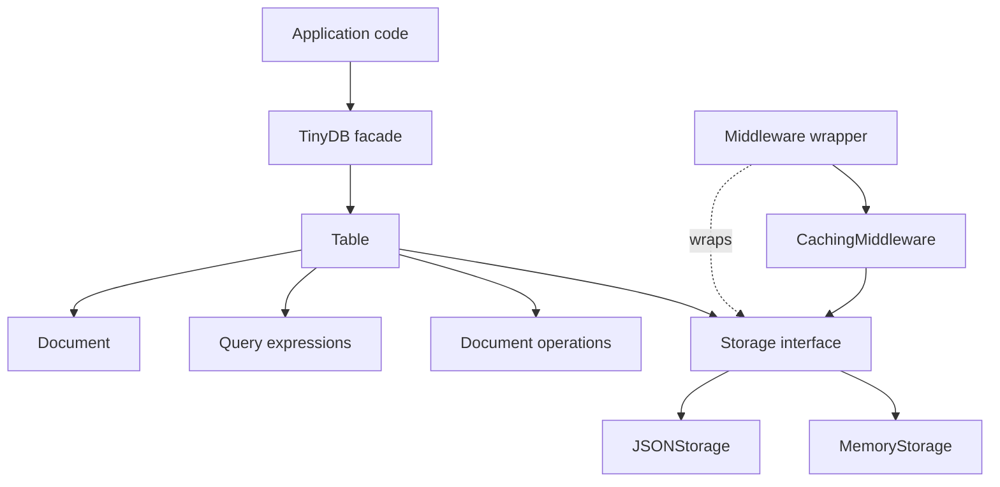

# TinyDB Architecture

## 1. System overview

TinyDB is a lightweight Python document database. Application code uses the `TinyDB` API to access named tables. A table manages documents, queries, and document identifiers, while a storage implementation persists the table data. Storage middleware can wrap a storage implementation to add behavior such as write caching.

The architecture is organized as a Python library with separable database, table, query, storage, middleware, and document-operation responsibilities. It is not a networked database server: application code calls its Python API directly.

## 2. Component architecture

### 2.1 TinyDB — `tinydb/database.py`

`TinyDB` is the public database facade. It creates and retrieves table objects, lists table names, drops individual tables or all tables, and coordinates access to the configured storage. It provides the entry point through which application code reaches table-level behavior.

### 2.2 Table and Document — `tinydb/table.py`

A `Table` represents a named collection of documents. It implements insertion, retrieval, searching, updating, upserting, removal, document-ID management, and query caching. A `Document` is dictionary-like data associated with a document ID. Table operations use these IDs to identify records and report which records were affected.

### 2.3 Query — `tinydb/queries.py`

The query component provides query expressions and condition evaluation. Table methods such as search, update, and removal use query conditions to select matching documents. Query expressions therefore connect the caller's selection criteria to table operations.

### 2.4 Storage — `tinydb/storages.py`

The storage layer separates persistence from table behavior. It defines the storage interface and provides concrete implementations, including `JSONStorage` and `MemoryStorage`. `JSONStorage` reads and writes JSON data in a file; `MemoryStorage` keeps the database data in memory.

### 2.5 Middleware — `tinydb/middlewares.py`

Middleware wraps a storage implementation and forwards storage access. `CachingMiddleware` buffers writes and flushes the cached data to the underlying storage. Its lifecycle matters: flushing and closing must preserve pending writes and the expected closed-state behavior.

### 2.6 Document operations — `tinydb/operations.py`

This module provides callable transformations for document fields, including `delete`, `add`, `subtract`, `set`, `increment`, and `decrement`. These callables can be used with table update behavior. They provide reusable field-level operations without requiring callers to write each transformation inline.

## 3. Component diagram

The diagram represents logical relationships visible in the source. It does not claim that every storage instance is wrapped by middleware.

## 4. Principal data flows

### 4.1 Database access

Application code creates a `TinyDB` instance and requests a named table. The database facade supplies the table object. The table performs document-level operations and delegates persistence through the configured storage implementation.

### 4.2 Query and update

The caller supplies a query expression to a table method. The table evaluates the condition against its documents. Depending on the operation, it returns matching documents, modifies matching documents, or removes them. Update transformations may be dictionaries or callables, including the callables provided by `tinydb.operations`.

### 4.3 Persistence and middleware

When table state is persisted, the storage implementation handles the underlying representation. With `JSONStorage`, data is serialized as JSON and written to a file. With `MemoryStorage`, data remains in memory. If `CachingMiddleware` is used, writes may be buffered before being flushed to the wrapped storage.

## 5. Architecture decision records

The repository does not contain standalone ADR files documenting these choices. The following records describe implementation decisions observable in the source. Where the source does not state the original motivation, that motivation is explicitly marked as inferred.

### ADR-1: Separate table behavior from persistence

- **Status:** Verified for the separation; Inferred for the design rationale.
- **Context:** Table operations need a persistence mechanism, but the implementation provides more than one storage backend.
- **Decision:** Database and table behavior interact with a storage abstraction, with concrete implementations such as `JSONStorage` and `MemoryStorage`.
- **Alternatives:** Embed JSON file handling directly in `Table`; duplicate table logic for each backend.
- **Consequences:** Storage implementations can be substituted without duplicating table-level behavior. Backend-specific behavior and errors remain the responsibility of the storage layer.
- **Evidence:** `tinydb/database.py`, `tinydb/table.py`, `tinydb/storages.py`.

### ADR-2: Extend storage behavior through middleware

- **Status:** Verified for wrapper and caching behavior; Inferred for the design rationale.
- **Context:** Behaviors such as write buffering can be implemented around storage rather than duplicated in every backend.
- **Decision:** Middleware wraps a storage implementation. `CachingMiddleware` buffers writes and flushes them to the underlying storage.
- **Alternatives:** Implement caching separately in each backend; place caching logic directly in `Table`.
- **Consequences:** Middleware can add storage behavior compositionally. Correct flush and close behavior is important because buffered data may not yet have reached the underlying storage.
- **Evidence:** `tinydb/middlewares.py`, `tests/test_middlewares.py`.

### ADR-3: Provide JSON file persistence

- **Status:** Verified for JSON persistence; Inferred for the selection rationale.
- **Context:** A lightweight database benefits from a persistent storage option that does not require a separate database server.
- **Decision:** `JSONStorage` serializes database state to a JSON file and supports configurable serialization options and file access modes.
- **Alternatives:** Provide only in-memory storage; require an external database server; use a different serialization format.
- **Consequences:** Database contents are human-readable JSON. File access mode, encoding, serialization options, and write lifecycle affect persistence behavior.
- **Evidence:** `tinydb/storages.py`, `tests/test_storages.py`.

## 6. Implementation constraints

1. **Python compatibility.** Project metadata declares Python `>=3.10,<4`. Changes should remain compatible with the declared range. Evidence: `pyproject.toml`.
2. **Storage abstraction.** Database and table behavior must continue to work through the storage interface rather than assuming a JSON file. Evidence: `tinydb/database.py`, `tinydb/table.py`, `tinydb/storages.py`.
3. **Document identity.** Document IDs are used to identify records. Explicit document IDs affect next-ID handling, so insert/update changes must preserve the existing ID semantics. Evidence: `tinydb/table.py`, `tests/test_tinydb.py`.
4. **Middleware lifecycle.** `CachingMiddleware` buffers writes and flushes them during its lifecycle, including close. Storage changes must remain compatible with middleware flush and close behavior. Evidence: `tinydb/middlewares.py`, `tests/test_middlewares.py`.
5. **JSON storage compatibility.** `JSONStorage` supports serialization options, encoding, and documented access modes. Changes to file-writing behavior must preserve these interfaces and relevant error behavior. Evidence: `tinydb/storages.py`, `tests/test_storages.py`.

## 7. Ten factual claims checked

| # | Claim | Source inspected | Status |
|---|---|---|---|
| 1 | `TinyDB` coordinates database and table access. | `tinydb/database.py` | Verified |
| 2 | The database can list table names and drop tables. | `tinydb/database.py` | Verified |
| 3 | `Table` supports document insertion and retrieval. | `tinydb/table.py` | Verified |
| 4 | `Table` supports update and upsert operations. | `tinydb/table.py` | Verified |
| 5 | The table manages document identifiers. | `tinydb/table.py` | Verified |
| 6 | Query expressions are used by table operations. | `tinydb/queries.py`, `tinydb/table.py` | Verified |
| 7 | `JSONStorage` reads and writes JSON file data. | `tinydb/storages.py` | Verified |
| 8 | `MemoryStorage` provides in-memory storage. | `tinydb/storages.py` | Verified |
| 9 | `CachingMiddleware` buffers and flushes writes. | `tinydb/middlewares.py` | Verified |
| 10 | Document operations include add, subtract, set, increment, decrement, and delete. | `tinydb/operations.py` | Verified |

## 8. Source review method and limitations

The architecture was derived from inspection of `database.py`, `table.py`, `queries.py`, `storages.py`, `middlewares.py`, and `operations.py`, together with related database, table, storage, middleware, and operation tests. The ten claims above are limited to behavior visible in the inspected implementation and tests.

The repository did not provide standalone ADRs for the three records in this document. Implementation structure and behavior are marked Verified; motivations not explicitly stated in the source are marked Inferred. The diagram describes source-level logical relationships and is not a runtime trace.

Researcher verification duration: record the actual time spent.
