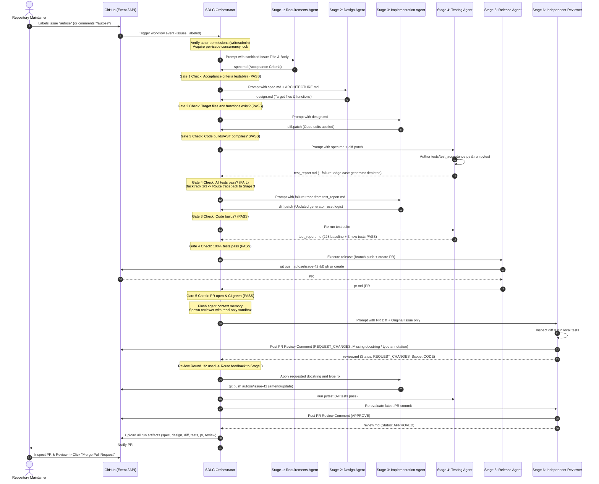

# Sequence View: End-to-End Workflow Execution

This sequence diagram illustrates a representative execution trace of an issue run, including a testing feedback loop (Stage 4 $\to$ Stage 3 backtrack) and a reviewer feedback loop (Stage 6 $\to$ Stage 3 backtrack), culminating in maintainer sign-off.

